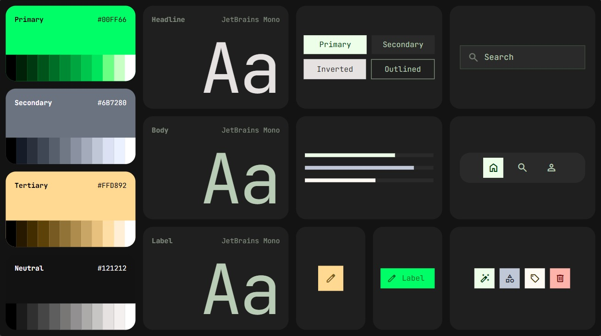

<h1 align="center">pSword</h1>

<p align="center">
  
</p>

<p align="center">
  <strong>Gestor de credenciales móvil, local y cifrado, con verificación de integridad mediante una cadena de bloques privada.</strong>
</p>

<p align="center">
  
  
  
  
  
  
</p>

---

## Tabla de contenido

1. [Descripción](#descripción)
2. [Características](#características)
3. [Arquitectura de seguridad](#arquitectura-de-seguridad)
4. [Arquitectura de la aplicación](#arquitectura-de-la-aplicación)
5. [Identidad visual](#identidad-visual)
6. [Tecnologías](#tecnologías)
7. [Estructura del proyecto](#estructura-del-proyecto)
8. [Instalación y ejecución](#instalación-y-ejecución)
9. [Generar el APK](#generar-el-apk)
10. [Estado del proyecto](#estado-del-proyecto)
11. [Limitaciones conocidas](#limitaciones-conocidas)
12. [Autores](#autores)

---

## Descripción

**pSword** es una aplicación móvil de código abierto para la **generación y gestión segura de credenciales**. Nace como respuesta a un problema frecuente: el uso de contraseñas débiles, predecibles o reutilizadas entre servicios.

La aplicación permite crear contraseñas robustas con aleatoriedad criptográfica y guardarlas en una **bóveda local cifrada** (`vault.pws`), protegida por una **contraseña maestra** que no se almacena en ningún lugar. Todo ocurre en el dispositivo: no hay servidor, nube ni telemetría, y las funciones principales no requieren conexión a Internet.

Como componente adicional, cada versión guardada de la bóveda se registra en una **cadena de integridad local** (blockchain privada de un solo nodo) que permite detectar modificaciones del archivo, manipulación del registro y sustitución por versiones anteriores.

> Proyecto académico desarrollado en la asignatura *Software con estándares de calidad: metodologías de desarrollo tradicionales*, Universidad de Cundinamarca.

---

## Características

### Seguridad

- **Contraseña maestra** que nunca se guarda: solo sirve para derivar las claves.
- **Derivación de clave con Argon2id** (RFC 9106) y sal aleatoria única por bóveda.
- **Cifrado autenticado XChaCha20-Poly1305**, con nonce nuevo en cada guardado y encabezado autenticado (AAD).
- **Cadena de integridad** con SHA-256 y firma HMAC-SHA-256 por bloque.
- **Ancla en el almacén seguro del sistema** (Keystore en Android, Keychain en iOS) para detectar rollback.
- **Recuperación ante cierres inesperados** durante un guardado.
- **Limpieza de memoria**: las claves y el texto plano se sobrescriben con ceros al bloquear.

### Funcionalidad

- Creación de la bóveda con contraseña maestra (mínimo 12 caracteres) y validación de coincidencia.
- Desbloqueo con verificación completa de integridad y mensajes de error específicos.
- **Generador de contraseñas** con longitud de 8 a 20 caracteres, grupos de caracteres configurables y opción de evitar caracteres ambiguos. Usa aleatoriedad del sistema operativo con muestreo por rechazo (sin sesgo de módulo).
- Alta y baja de credenciales: inicio de sesión web, tarjeta y nota segura.
- Bóveda con búsqueda, filtros por tipo, mostrar u ocultar contraseña y copiar al portapapeles.
- Bloqueo de la bóveda con borrado de claves en memoria.

---

## Arquitectura de seguridad

### Flujo de claves

```text
Contraseña maestra ──► Argon2id (sal de 16 bytes) ──► 64 bytes
                                                        │
                                  ┌─────────────────────┴─────────────────────┐
                                  ▼                                           ▼
                        Clave de cifrado (32 B)                    Clave de firma MAC (32 B)
                      XChaCha20-Poly1305 (bóveda)                HMAC-SHA-256 (cadena de integridad)
```

Ninguna clave se reutiliza para dos propósitos.

### Parámetros de Argon2id

| Parámetro | Valor |
|---|---|
| Variante | Argon2id v1.3 |
| Iteraciones (t) | 2 |
| Memoria | 19 MiB |
| Paralelismo (p) | 1 |
| Sal | 16 bytes aleatorios, única por bóveda |

Corresponden al mínimo recomendado por OWASP. Se guardan en el encabezado del archivo, por lo que pueden endurecerse en el futuro sin invalidar bóvedas existentes. Al abrir un archivo se rechazan valores fuera de rango (memoria de 8 a 512 MiB, iteraciones de 1 a 20) para evitar encabezados manipulados.

### Formato del archivo `.pws` (versión 1)

Archivo JSON de texto. Solo el contenido está cifrado; el encabezado no es secreto, pero queda autenticado.

```json
{
  "format": "pSword-vault",
  "version": 1,
  "kdf":    { "alg": "argon2id13", "opslimit": 2,
              "memlimit": 19922944, "salt": "<Base64, 16 bytes>" },
  "cipher": { "alg": "xchacha20poly1305-ietf",
              "nonce": "<Base64, 24 bytes>" },
  "ciphertext": "<Base64>",
  "tag": "<Base64, 16 bytes>"
}
```

### Cadena de integridad

Cada guardado agrega un bloque. La cadena no contiene contraseñas: solo hashes del archivo cifrado.

| Campo | Descripción |
|---|---|
| `index` | Número de versión; 0 es el bloque génesis |
| `date` | Fecha y hora del guardado (ISO 8601) |
| `vaultHash` | SHA-256 del archivo `.pws` cifrado tal como quedó escrito |
| `prevHash` | Hash del bloque anterior (el génesis usa 64 ceros) |
| `hash` | SHA-256 de `index │ date │ vaultHash │ prevHash` |
| `signature` | HMAC-SHA-256 del hash del bloque con la clave MAC |

Cada capa detecta una amenaza distinta:

- **Enlaces y hashes:** edición o borrado de bloques intermedios.
- **Firma HMAC:** impide reconstruir una cadena válida sin la contraseña maestra.
- **Ancla en SecureStore:** detecta que archivo y cadena fueron reemplazados por una versión anterior.

### Resultados de verificación al desbloquear

| Resultado | Condición |
|---|---|
| `WRONG_PASSWORD` | El descifrado falla y el archivo coincide con lo registrado |
| `file-altered` | El archivo no coincide con ninguna versión registrada |
| `rollback` | El archivo coincide con una versión anterior de la cadena |
| `chain-missing` | Falta el archivo de cadena |
| `chain-corrupt` | Hash o enlace de un bloque inválido |
| `chain-bad-signature` | Firma HMAC inválida |
| `chain-truncated` | La cadena es más corta que el ancla |
| `chain-diverged` | El bloque del ancla no coincide con la cadena |

### Modelo de amenazas

| Amenaza | Protección |
|---|---|
| Robo del archivo `.pws` | Cifrado autenticado con clave derivada con Argon2id |
| Fuerza bruta sobre la contraseña | Argon2id con coste en memoria y tiempo; sal única |
| Modificación del archivo | Etiqueta Poly1305 y hash registrado en la cadena |
| Edición de la cadena | Enlaces, hashes y firmas HMAC |
| Sustitución por una versión anterior | Ancla en SecureStore y comparación con el último bloque |
| Cierre inesperado durante un guardado | Orden de escritura fijo y recuperación al desbloquear |

---

## Arquitectura de la aplicación

La aplicación se organiza en capas con dependencias en un solo sentido, de arriba hacia abajo. El núcleo de seguridad no conoce la interfaz y accede al almacenamiento mediante una interfaz (`VaultStorage`), lo que permite probarlo sin el teléfono.

```text
┌──────────────────────────────────────────────────────────┐
│  Pantallas (src/app)                                     │
├──────────────────────────────────────────────────────────┤
│  Contexto de sesión (src/context/VaultContext.tsx)       │
├──────────────────────────────────────────────────────────┤
│  Orquestación (core/vaultManager.ts)                     │
├───────────────────────┬──────────────────────────────────┤
│  vaultFile.ts         │  integrityChain.ts               │
│  Formato .pws         │  Bloques, firmas y verificación  │
├───────────────────────┴──────────────────────────────────┤
│  crypto.ts (única capa que invoca primitivas)            │
├──────────────────────────────────────────────────────────┤
│  storage.ts (archivos del dispositivo + ancla SecureStore)│
└──────────────────────────────────────────────────────────┘
```

**Decisiones de diseño**

- **Capa criptográfica única:** los algoritmos y parámetros viven en `crypto.ts`; cambiar de librería no afecta al resto del código.
- **Núcleo independiente de la plataforma:** recibe el almacenamiento por inyección.
- **Datos mínimos en el almacén seguro:** `SecureStore` guarda solo el ancla (un índice y un hash).
- **Cadena separada del `.pws`:** cada bloque contiene el hash del archivo, por lo que incluirla dentro cambiaría ese hash.
- **Parámetros dentro del archivo:** permite endurecer la derivación sin romper bóvedas anteriores.

---

## Identidad visual

La interfaz sigue una estética de terminal: fondo oscuro, verde de alto contraste y tipografía monoespaciada.

<p align="center">
  
</p>

| Rol | Color | Uso |
|---|---|---|
| Primario | `#00FF66` | Acciones principales, acentos y estados correctos |
| Secundario | `#6B7280` | Texto auxiliar y elementos neutros |
| Terciario | `#FFD892` | Avisos y elementos de edición |
| Neutro | `#121212` | Fondo de la aplicación |

**Tipografía:** JetBrains Mono para titulares, cuerpo y etiquetas.

---

## Tecnologías

| Área | Tecnología |
|---|---|
| Aplicación | React Native 0.86, React 19, Expo SDK 57 |
| Lenguaje | TypeScript |
| Navegación | Expo Router (rutas basadas en archivos) |
| Derivación de clave | Argon2id (`@noble/hashes`) |
| Cifrado autenticado | XChaCha20-Poly1305 (`@noble/ciphers`) |
| Hash y firma | SHA-256 y HMAC-SHA-256 (`@noble/hashes`) |
| Aleatoriedad | `expo-crypto` |
| Almacén seguro | `expo-secure-store` |
| Portapapeles | `expo-clipboard` |
| Compilación | EAS Build |
| Control de versiones | Git y GitHub |

Las librerías `@noble/*` son JavaScript puro, auditadas y sin dependencias nativas, por lo que la aplicación se ejecuta en **Expo Go** sin compilar un APK de desarrollo.

---

## Estructura del proyecto

```text
pSword/
├── assets/
│   └── images/                  # Logo, banner, paleta e íconos
├── src/
│   ├── app/                     # Pantallas (Expo Router)
│   │   ├── _layout.tsx
│   │   ├── index.tsx            # Ingreso y desbloqueo
│   │   ├── setup-password.tsx   # Creación de la bóveda
│   │   ├── boveda.tsx           # Lista de credenciales
│   │   ├── generador.tsx        # Generador de contraseñas
│   │   ├── nueva-credencial.tsx # Alta de credenciales
│   │   └── evidencia.tsx        # Solo desarrollo (ver nota)
│   ├── components/
│   │   └── boveda/              # Tarjetas del generador, parámetros e historial
│   ├── context/
│   │   └── VaultContext.tsx     # Estado de sesión
│   └── core/
│       ├── vaultManager.ts      # Crear, desbloquear, guardar, bloquear
│       ├── vaultFile.ts         # Formato .pws
│       ├── integrityChain.ts    # Cadena de integridad
│       ├── crypto.ts            # Primitivas criptográficas
│       ├── passwordGenerator.ts # Generador
│       ├── storage.ts           # Archivos y ancla en SecureStore
│       ├── encoding.ts          # Base64, hexadecimal y UTF-8
│       └── types.ts
├── app.json
├── eas.json
├── package.json
└── tsconfig.json
```

> **Nota:** `evidencia.tsx` es una pantalla de demostración que solo se enlaza en modo desarrollo (`__DEV__`). Permite mostrar el archivo cifrado y simular ataques sobre la bóveda. **Debe eliminarse, junto con su enlace en `index.tsx`, antes de publicar una versión final.**

---

## Instalación y ejecución

### Requisitos

- [Node.js](https://nodejs.org) LTS
- [Git](https://git-scm.com)
- [Expo Go](https://expo.dev/go) en el teléfono, o un emulador de Android

### Pasos

```bash
git clone https://github.com/DedsecRay69/pSword.git
cd pSword
npm install
npx expo start -c
```

Escanea el código QR con Expo Go, o pulsa `a` para abrir el emulador de Android. El teléfono y el equipo deben estar en la misma red; si no conecta, usa `npx expo start --tunnel`.

> En Windows PowerShell, si los scripts están bloqueados, usa `npm.cmd` y `npx.cmd` en lugar de `npm` y `npx`.

---

## Generar el APK

La compilación se realiza en la nube con [EAS Build](https://docs.expo.dev/build/introduction/).

```bash
npm install -g eas-cli
eas login
eas build -p android --profile preview
```

El perfil `preview` de `eas.json` debe producir un APK instalable:

```json
{
  "build": {
    "preview": {
      "distribution": "internal",
      "android": { "buildType": "apk" }
    }
  }
}
```

Al terminar, la terminal y la página del build en [expo.dev](https://expo.dev) muestran el enlace de descarga. El identificador de la aplicación es `com.raylovult.psword`; no debe cambiarse después de distribuir el APK, porque Android lo trataría como otra aplicación.

---

## Limitaciones conocidas

- Un atacante con control total del dispositivo desbloqueado, o con malware que lea la memoria mientras la bóveda está abierta, no es detenido por estos mecanismos.
- Si el atacante también puede escribir en `SecureStore`, puede mover el ancla. Se asume que el Keystore/Keychain protege ese almacén.
- La contraseña maestra olvidada **no se puede recuperar**; es una decisión de diseño.
- La cadena es **local y de un solo nodo**: detecta alteraciones, pero no las impide, y no existe consenso distribuido. El anclaje externo en una red pública es trabajo futuro.
- Los strings de JavaScript no se pueden borrar de memoria de forma garantizada; al bloquear se sobrescriben las claves y se liberan las referencias.

---

## Autores

- **Juan "Ray" Andrés Castro**
- **Jesús "LoVult" Ángel Granados**
